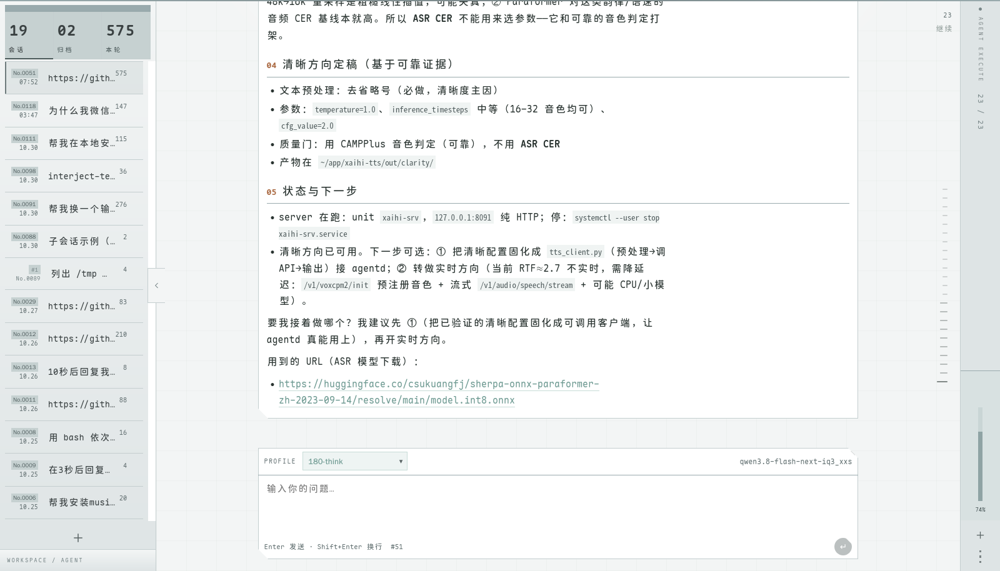
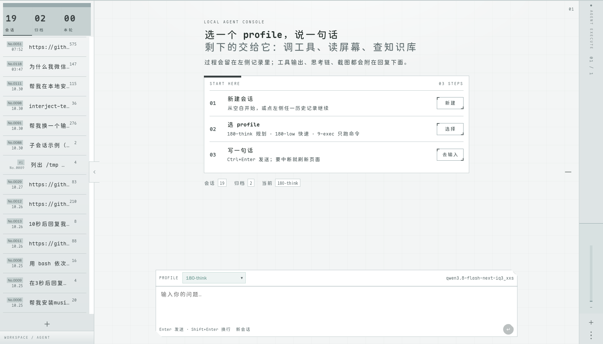
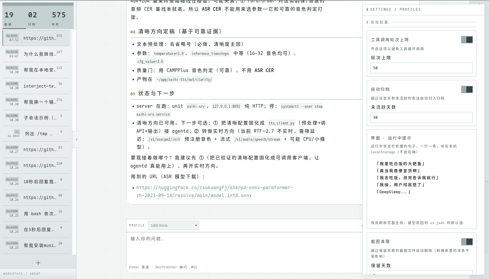
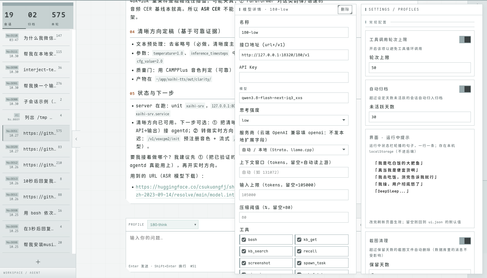
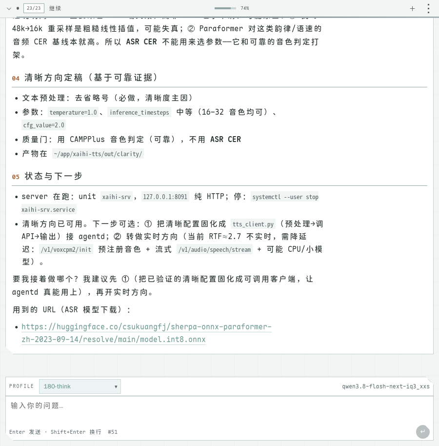
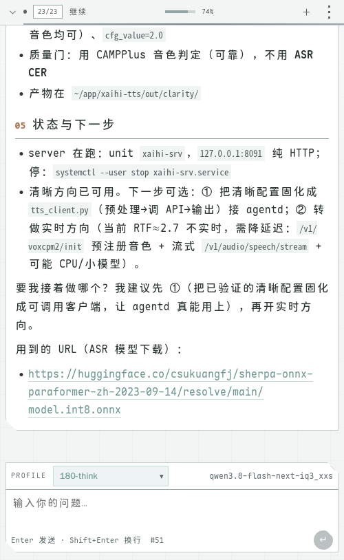

# agentd 审计报告

分级依据：P0 崩溃/报错/数据不一致 → P1 卡顿/状态错乱/响应式破坏/同角色样式不统一 → P2 与风格不合时宜/点击目标过小。

每条格式：**现象 → 根因 → 修复 → 验证**。已修的只写验证过的结论，没证据的不下判断（见文末「审计中排除的误报」）。

## 审计环境

| 项 | 值 |
|---|---|
| 后端 | `127.0.0.1:18400`（systemd user unit `agentd`） |
| 数据库 | `~/.data/agentd/agentd.db`（WAL） |
| 浏览器 | geckodriver 4444 + Firefox headless |
| 视觉验证 | `scripts/ui-test/pixel_diff.py`，6 张固定页面/尺寸 |
| 基线 | `~/.data/agentd/pixel-base/`（不放 `/tmp`；每次**刻意**改视觉后重拍，其余改动必须逐像素不变） |

审计起点的自检：对**未改动的 HEAD 构建**跑一次 `pixel_diff compare`，6/6 逐像素一致，证明截图链路确定性足够、基线有效。此后任何视觉提交都必须保持「除刻意改动的那几张外，其余逐像素不变」。

> 文中的 `theme.css:NNN` 是**改动当时**的行号。第 8 批把 7 个 `:root` 合并成一个之后整体前移了 26 行，现在对不上 —— 按选择器找，别按行号。

---

## P0 — 崩溃 / 报错 / 数据不一致

### P0-1 测试脚本往真实会话写数据 ✅ 已修

**现象**：真实对话 `conv=118` 的末尾出现 6 条不该有的消息 —— `No.148 / 150 / 152` 是内容为 `rb-test` 的用户消息，`No.149 / 151 / 153` 是内容为 `（已停止）` 的 assistant 消息。用户从没发过这些。

**根因**：`scripts/ui-test/robustness.py` 把真实会话当测试靶子：

- `[3] 超长输入`（第 52 行）：`s.get(BASE + "/?conv=118")`，然后往 textarea 灌 10000 个 `x`
- `[4] 快速连点发送`（第 67 行）：同样打开 `?conv=118`，填 `rb-test`，**真的点 5 次发送按钮**

所以每跑一次 robustness 就多一轮真实消息，还要调用一次真实模型。跑过 3 次 → 6 条垃圾。

同类问题还有一处：`[4]` 收尾停任务时不看 conv_id，`for cid in running: stop` —— 会顺手停掉用户正在跑的那一轮。

**修复**：

- 新增 `new_conv()`，用 SQLite 自建一个会话当靶子（会话表结构简单，且测试脚本本来就有写库权限）；`[3][4]` 全部改用自建会话，不再出现硬编码的真实 conv id
- 停止逻辑加 `if str(cid) != rb_conv: continue`，只停自己这一轮
- 新增 `dispose()`，跑完把自建会话连同消息真删（原先用 `DELETE /api/conv/<id>`，那只是 `archived=1`，仍占会话列表位）
- `stream_test.py` 同样补上收尾清理，同样从「归档」改为「删」

**验证**：

- 清理前备份：`agentd.db.bak-audit-20261103-035417`
- 删除 `conv=118` 的 `seq 148..153`：消息数 153 → 147，`max(seq)` 153 → 147
- 全库 `rb-test` 分布复查：只剩 `conv=118` 的 3 条，删除后归零
- 重跑 `robustness.py`：0 个问题，且 `conv=118` 残留检查输出 `0`
- 清理全部测试会话（`stream-test` / `uitest` / `ui-rb`）：会话总数 29 → 23

### P0-2 传了不存在的会话 id 会静默新建 ✅ 已修

**现象**：`POST /api/chat` 带 `{"conv_id":"999999","text":"hi"}`，返回的不是报错，而是一个**新会话**的 SSE 帧（`{"conv_id":"173","title":"新会话"}`），并且真的跑完了一轮，往新会话里写了 2 条消息。

**根因**：`Agent.Conversation(id)` 的实现是「读不到就新建」：

```go
if id != "" {
    if c, err := a.st.Get(id); err == nil {
        return c, nil
    }
}
// 读不到 → 掉到这里，静默新建
return &store.Conversation{ID: a.st.NextID(), Title: "新会话", ...}, nil
```

而且它**永远返回 nil 错误**，所以 `handleChat` 里那段 `if err != nil { send("error", ...) }` 是死代码 —— 从来没执行过。

**后果**（数据不一致）：前端把 conv_id 拼错时，消息会悄悄写进一个新会话，用户以为还在原会话；每一次这样的请求还会真实调用一次模型（白烧）。

**修复**：区分三种输入 —— 空 id 才是新建；传了 id 但读不到必须报错。

**验证**：
- 单元测试 `TestConversationResolution`：空 id 新建、存在 id 原样返回、带首尾空白的 id 能匹配、不存在的 id 报错**且不产生新会话**
- 部署后实测：`{"conv_id":"999999"}` → `event: error` + `{"error":"会话 \"999999\" 不存在或读不出来：file does not exist"}`，会话数保持 21
- `go test ./...` 全绿

**顺带**：CLI 的 `agentd ask -conv <id>` 现在会 `fatal` 而不是静默新开 —— 它本来就处理了 err 分支，只是从前永远拿不到错误。

### P0-3 `/shots/` 目录遍历：整个数据库可下载 ✅ 已修

**这是本轮最严重的发现。**

**现象**：

```
GET /shots/..%2Fagentd.db  →  200  20586496 bytes
```

20MB，正是 `~/.data/agentd/agentd.db` —— 全部 1714 条对话消息、会话元数据、配置。同样的手法能拿到 `ui.json`，再编码几层理论上还能走到上一级目录。

**根因**：两个问题叠在一起。

```go
mux.HandleFunc("/shots/", func(w http.ResponseWriter, r *http.Request) {
    home, _ := os.UserHomeDir()
    http.FileServer(http.Dir(filepath.Join(home, ".data", "agentd"))).ServeHTTP(w, r)
})
```

1. **`FileServer` 的根是 `~/.data/agentd` 而不是 `shots/`。** 因为 URL 前缀也得参与映射，`/shots/x.png` 落到 `~/.data/agentd/shots/x.png` —— 看起来"刚好对"，实则把整个父目录（套着数据库和配置文件）都暴露了。
2. **`http.Dir` 的越界防护挡不住 URL 编码。** 它用 `path.Clean("/"+name)` 做清理，但清理发生在**解码之前**：`..%2F` 在 Clean 眼里只是一个普通片段，Clean 之后才解码成 `../`。

**修复**：先把前缀剥掉，再让 FileServer 的根直接落在 `shots/` 上：

```go
dir := http.Dir(filepath.Join(home, ".data", "agentd", "shots"))
http.StripPrefix("/shots/", http.FileServer(dir)).ServeHTTP(w, r)
```

这样 `..` 无论怎么编码，Clean 之后都还在 `shots` 之下。

**验证**：
- 越界 `/shots/..%2Fagentd.db`、`/shots/..%2Fui.json`、`/shots/..%2F..%2F.ssh%2Fid_rsa` → 全部 **404**
- 正常截图 `/shots/1793375166786760459.png` → **200**，2.5MB 正常返回
- `/shots/../agentd.db` 会 307 到 `/agentd.db`，那个路径由 `handleStatic` 处理 → 404
- 三条越界用例已固化进 `check_api.py`，34 条全过

**教训**：这个洞一直在，只是没人试过编码后的 `..`。前面的审计都在看"功能对不对"，没看"能不能被滥用" —— 而 `http.FileServer` + 手拼 `http.Dir` 是最容易踩的一类。

### P0-4 跨站请求伪造：任意网页都能让 agentd 跑一轮 ✅ 已修

**现象**：

```
POST /api/chat   Content-Type: text/plain
{"conv_id":"207","text":"只回复两个字：好的"}
→ 200  event: meta   会话里落了 2 条消息
```

后端只读 body、不看 `Content-Type`。而 `text/plain` 属于 CORS 的**简单请求**，浏览器**不触发预检**，请求照常送达。

**攻击成本**：随便一个网页里一行 `fetch` 就够。响应因为没给 CORS 头读不到，但**副作用已经发生** —— 这一轮真的会跑，而模型手上是 `bash` 工具。

**根因**：服务端没有任何 CSRF 防护，`handleChat` 直接 `json.NewDecoder(r.Body).Decode(...)`。之前"看起来还好"是因为表单的 `enctype=text/plain` 会拼成 `key=value` 而不是纯 JSON，解析失败；但 `fetch` 能直接发纯 JSON。

**修复**：加 `requireJSONBody` 中间件 —— 所有带 body 的 POST/PUT/PATCH 必须声明 `application/json`，否则 415。浏览器发这个类型**必然先发 OPTIONS 预检**，而不给 CORS 头的服务端不会放行预检。用 `ContentLength != 0`（而非 `> 0`）把 chunked 的 -1 也一起要求；无 body 的 POST（停止生成）照旧放行。

**验证**：
- `text/plain` + JSON body → **415**
- `application/json` → 正常
- 无 body 的 `POST /api/conv/51/stop` → 404（"这一轮已经结束"，不是被中间件拦）
- `check_api` 34 条 + `check_live` / `check_sendstop` / `stream_test` / `robustness` / `run*` 全绿
- 5 处 Go 测试的请求补了 Content-Type（真客户端都带，是测试漏了）

### P2-10 没有任何安全响应头 ✅ 已修

**现象**：`X-Frame-Options` / `X-Content-Type-Options` / `Referrer-Policy` 一个都没有。

**风险**：
- 没有 `X-Frame-Options`：任意页面能把界面 iframe 进去做点击劫持（透明浮层盖在「删除插件」上）
- 没有 `nosniff`：浏览器可能把 JSON 响应猜成 HTML 去执行
- 没有 `Referrer-Policy`：URL 里带 conv id，会随外链带出去

**修复**：加 `secureHeaders` 中间件，三个头一起给。**刻意不加 CORS 头** —— 跨站读不到任何响应，这正是想要的。

**验证**：`curl -I` 三个头都在；用 JS 建 iframe 加载同源页面，`contentDocument` 为 `null`（被 DENY 拒绝）。


### P1-10 插话失败却回 200 ✅ 已修

**现象**：`POST /api/conv/999999/interject` 返回 `{"mode":"turn","ok":true}` + **200**，可那个会话根本不存在。后台只留下一行 `[WARN] interject->turn conv=999999: file does not exist`，客户端以为「接着做」已经生效了。

**根因**：`handleInterject` 在「当前没在跑 → 当普通消息起一轮」这条分支里，把 `runTurn` 丢进 goroutine 后**立刻回 200**。goroutine 里的失败只进日志，没有任何通道能回到 HTTP 响应。兜底那句也是 `200 + ok:false` —— 状态码照样算成功。

**为什么今天才暴露**：P0-2 修好之前，`runTurn` 遇到不存在的 id 会**静默新建**，这条路径「看起来成功，居然也真的成功」；`Conversation()` 一改成报错，同一个 200 立刻变成谎言。**两个 bug 叠在一起时，前一个把后一个挡住了**。

**修复**：
- 该分支在起 goroutine 之前先 `s.st.Get(id)` 确认会话存在，读不到直接 404
- 兜底的「会话不在运行且无法起新回合」从 200 改成 **400**

**验证**：`POST /api/conv/999999/interject` → `404 {"error":"没有这个会话"}`，会话数保持 21。前端 `interject()` 本来就写了 `if (!r.ok) { setStatus('✗ 插话失败'); return }` —— 这条分支以前永远触发不到，现在有了。

### P1-11 归档 / 恢复 / 删除不存在的会话也报成功 ✅ 已修

**现象**：`DELETE /api/conv/999999` 返回 `{"archived":"999999","ok":true}` + 200。客户端以为归档成功，库里其实什么都没变。

**根因**：`SQLiteStore` 的三个方法只看 `Exec` 返回的 error：

```go
func (s *SQLiteStore) Archive(id string) error {
	_, err := s.db.Exec(`UPDATE conversations SET archived=1 WHERE id=?`, id)
	return err
}
```

而 `UPDATE ... WHERE id=999999` 命中 0 行**不算错误**，`err` 是 nil。`Restore` 和 `Delete` 是同一个写法。

**怎么发现的**：新写 `check_api.py`，对 15 个端点逐个发不同方法、比对预期状态码。31 条用例里 11 条不符合预期 —— 其中 8 条是**我自己预期写错了**（`/api/context` 和 `/api/models` 本来就要参数，400 才对），剩下 3 条里最严重的是这条。

**修复**：三个方法都检查 `RowsAffected()`，0 行返回 `os.ErrNotExist`。`Delete` 的硬删分支检查 `conversations` 的删除行数（先删 messages 可能 0 行，那是正常的），软删分支直接委托给 `Archive`。

**验证**：
- 单元测试 `TestArchiveRestoreDeleteMissingID`：四个方法对不存在的 id 都报错，**存在的会话照常成功**（不能为了判不存在把正常路径弄坏），硬删之后读不到
- 部署实测：`DELETE /api/conv/999999` → `404 {"error":"归档失败：file does not exist"}`；自建会话归档 → 200、恢复 → 200；会话数保持 21


---

## P1 — 状态错乱 / 响应式破坏 / 同角色样式不统一

### P1-1 空状态按钮与卡片按钮是两套语言 ✅ 已修

**现象**：新建会话页 `START HERE` 卡片右侧三个按钮（`新建` / `选择` / `去输入`）与右侧设置面板里的按钮观感完全不同。

**根因**：`.empty .step button`（`theme.css:81`）是 2026-10-25 样式重写**之前**留下的规则：

```css
.empty .step button{border:1px solid var(--line);background:#fff;padding:.32rem .7rem;
  font-size:.8rem;clip-path:polygon(0 0, calc(100% - 8px) 0, 100% 8px, 100% 100%, 0 100%)}
```

它用 `clip-path` 切掉右上角。而重写后确立的按钮语言是 `.btn`（`theme.css:320`）—— 直角 + 左上/右下 **L 形角标** + `--c4` 细边 + 悬停反色填充 + `0.74rem` + 字距。重写时新增了 `.btn` 体系，但空状态面板没被纳入，于是同一产品里并存两种按钮形制。

**修复**：把按钮体系从「卡片私有」提升为「全局」—— `.card .btn` → `.btn`（15 条规则）。`.btn` 此前只在 `.card` 内使用，去前缀不改变任何现有元素的计算样式。空状态三个按钮加 `className="btn"`，删除旧规则，只保留布局约束：

```css
.empty .step .btn{justify-self:end;min-width:4.4rem}
```

**验证**：
- `pixel_diff compare`：`wide-conv51` / `wide-conv118` / `wide-settings` / `narrow-conv51` **4 张逐像素完全一致**；仅 `wide-empty`(2114px) 与 `narrow-empty`(2114px) 不同，差异包围盒 `71×171` 恰好是按钮那一列 —— 证明改动没有外溢到其它页面。
- 修复前实测宽度：`新建` 43px、`选择` 42px、`去输入` 62px（右对齐、左边缘参差）；修复后三者等宽。

### P1-2 空状态按钮宽度参差 ✅ 已修

**现象**：三个按钮右边缘齐、左边缘参差，因为宽度只由 `padding + 文字数` 决定（2 字 vs 3 字）。

**根因**：`.step` 是 `grid-template-columns:2.2rem 1fr auto`，`auto` 列宽度随每个按钮文字自适应；没有任何统一宽度的约束。

**修复**：同 P1-1 的 `.empty .step .btn{min-width:4.4rem}`（`4.4rem` ≈ 70px，覆盖最宽的 3 字按钮）。

**验证**：像素差异包围盒宽 71px，与 `min-width` 一致；三个按钮左边缘对齐。

### P1-3 `isShotPlaceholder` 不看 Role ✅ 已修

**现象**：没有立即暴露的症状 —— 这正是它危险的地方。

**根因**：函数只判断「这条消息带图」且「正文以（上一个工具的截图开头」：

```go
return len(m.Images) > 0 && strings.HasPrefix(m.Content, "（上一个工具的截图")
```

没看 `Role`，所以一条 **assistant** 消息只要带了图、正文又碰巧以那句开头，也会被判成「用户提问的截图占位」。它没出事，纯粹因为唯一调用方 `convWindow` 在外部先判了 `all[i].Role == "user"` —— 换个调用方就会踩。

**怎么发现的**：写单元测试时把这个条件列进去，测试直接 FAIL（`classify_test.go:84`）。这是本轮唯一由测试而非截图发现的 bug。

**修复**：角色判断收进函数本身。同时修的时候踩了一次坑 —— 顺手把外层的 `Role == "user"` 也删了，结果 assistant 消息全被算成一轮（`total=6` 而不是 3），全量 `go test` 当场 FAIL。两个判断是两件事：函数内判 role 防误用，外层判 role 是因为「一轮必须由一条 user 消息开头」。已在代码里写清楚，免得下一个人又觉得冗余删掉。

**验证**：`go test ./...` 全绿；黑盒 `check_tools` 的 `data-seq 严格递增 n=99`、`run2` 的轮次显示都正常。

### P1-4 渲染一抛错就整页白屏 ✅ 已修

**现象**：页面上没有任何兜底 —— 某个组件渲染抛错时，用户看到的是纯白，既没有错误信息也没有刷新入口。

**根因**：入口 `main.jsx` 直接 `render(<App />)`，没有错误边界。React 18 的默认行为是渲染期抛错就**卸载整棵树**。触发源不难遇到：脏 `kv`、老缓存、后端返回了预期外的结构。

**修复**：新增 `ErrorBoundary.jsx`，在 `main.jsx` 里包住 `<App />`。出错时显示错误消息、前 6 行堆栈、「重新加载」按钮，并 `console.error` 带上 componentStack。样式复用现成的 `.btn` 和色阶变量，不引入新的视觉语言。

**验证**：
- 临时在 `App()` 顶部插一行按 URL 抛错的代码，构建后访问 `?_crash_test=1`：`.crash` 出现、`crash-msg` 是「boundary 自检：故意抛错」、按钮是「重新加载」
- 还原注入后 `grep -c _crash_test` 为 0，重新构建
- `pixel_diff` 6/6 逐像素一致 —— 正常路径完全不受影响

**边界**：错误边界只接渲染/生命周期里的同步错误，接不到事件回调和异步错误（那些仍走 `window.onerror`）。

### P1-5 样式变量散在 7 个 `:root` 里，同名变量被覆盖 2–3 次 ✅ 已修

**现象**：改一个颜色变量常常「不生效」，或者只对一部分元素生效 —— 因为它在后面被同名声明又覆盖了一次。

**根因**：`theme.css` 里有 **7 个 `:root`**，横跨 1400 行。脚本统计后：

| 变量 | 定义次数 |
|---|---|
| `--ink` / `--ink2` / `--ink3` | 各 3 次 |
| `--panel` / `--line` / `--sage` / `--sage-d` / `--side` / `--side2` / `--side-fg` / `--side-dim` / `--signal` / `--on-signal` / `--theme` / `--ef-on-signal` | 各 2 次 |

更绕的是开头那个 `:root` **引用了 `--c1..--c7`，而它们到第 397 行才定义**。CSS 变量惰性求值，所以能跑，但读代码的人会以为色阶是在开头定的。

**修复**：用脚本合并成一个 `:root`，每个变量取「最后出现者」的值 —— 同选择器、同层级（没有 `@media` 包裹），后出现者胜出，所以合并后级联结果完全一致。

做法上先保底：合并前导出 51 个变量的最终值，合并后重新解析并**逐项比对**，数量和值全部相同才写回。脚本第一次跑就报了 5 个变量丢失（`--c1`、`--paper`、`--side`、`--ef-ink`、`--warm`）—— 全是各分组的第一个，因为「分组注释 + 第一个变量」被当成同一段跳过了。修好解析器才通过。

**验证**：`pixel_diff` **6/6 逐像素一致**，文件 1420 → 1394 行。

### P1-6 `web/node_modules` 被提交进仓库 ✅ 已修

**现象**：`git ls-files` 共 2488 个文件，其中 **2352 个**是 `web/node_modules` 下的依赖 —— 占全仓 94%。`.git` 已经 43M。

**根因**：`.gitignore` 里确实有 `node_modules/`，但这些文件在加规则**之前**就已经进了索引。`.gitignore` 只对未跟踪文件生效，已经在索引里的照旧跟踪。

**后果**：每装一次依赖就产生大段无意义 diff；`git status` 长期噪音；clone 变慢；真正要 review 的改动被淹没。这不是界面 bug，但直接影响「改动能不能被看清」，属于同类问题的上游。

**修复**：`git rm -r --cached web/node_modules` —— 只移出索引，工作区文件不动 —— 然后提交。

**验证**：跟踪文件 2488 → 136；`ls web/node_modules` 内容仍在；`npm run build` 仍正常产出。


---

## P2 — 与当前风格不合时宜 / 点击目标过小

### P2-1 表单下拉框仍是浏览器默认箭头 ✅ 已修

**现象**：设置 → 模型详情的「思考强度」「服务商」两个下拉框，右侧是浏览器给出的细箭头；而输入框上方「PROFILE」下拉框用的是自定义 `▾`（深绿灰、更粗）。同一产品里并存两种下拉箭头。

**根因（已核实，非目测）**：`.composer .pick select`（`theme.css:119`）设了 `appearance:none` 并额外渲染 `<span className="caret">▾</span>`；`.card .field select`（`theme.css:303`）只给了边框和底色，**没有重置 `appearance`**，箭头因此来自 UA 而不是样式表。

证据（改前）：打开模型详情后取计算样式 —— `appearance: "auto"`、`backgroundImage: "none"`、`backgroundColor: rgb(255,255,255)`。截图 `model_before.png`（1600×1000）。

**修复**：给 `.card .field select` 重置 `appearance`，箭头用两个 45°/135° 渐变拼出 V 形 —— 之所以不用 data-URI 图标，是因为 URI 里的颜色写死，而渐变可以直接吃 `--ink2` 变量，换主题时箭头跟着变。另外把同族规则的 `background:#fff` 改成 `background-color:#fff`：`background` 简写会把 `background-image` 一起重置，不改这里箭头就会被吃掉。

**验证**：
- 计算样式：`appearance:"none"`，`backgroundImage` 为两个 linear-gradient
- **顺带修掉一处高度不齐**：改前 select 高 30px、input 高 35px（`getBoundingClientRect`）；改后 select 35px，与全部 7 个 input 齐平
- 像素对比：`wide-conv51` 内容区（x>260）**完全一致**，证明不影响会话页；`wide-settings` 的差异只有 `x 1521–1539` 一条 18px 竖带，即控件右端箭头/spinner 所在

### P2-2 数字输入框的原生 spinner ✅ 已修

**现象**：模型详情的「上下文窗口 / 输入上限 / 压缩阈值」、设置一级卡的「轮次上限 / 未活跃天数 / 保留天数」，右端都有 UA 的上下小箭头（spinner）。

**根因**：`<input type="number">` 未处理 `appearance` 与 `::-webkit-inner-spin-button`。已核实这些字段确实是 `type="number"`（`ModelForm.jsx:43/48/53`、`ListCard.jsx:30/45/70`、`ToolCard.jsx:34`）。

**修复**：`.card .field input[type=number]{appearance:textfield}`，并隐藏 `::-webkit-outer-spin-button` / `::-webkit-inner-spin-button`。

**判断依据**：这些字段里只有「轮次上限 50 / 未活跃天数 30 / 保留天数 7」是 ±1 有意义的小整数；模型那边的都是五位数（131072、105000），spinner 每次 ±1 毫无意义，而它本身只有 8px 宽，属于点击目标过小。

**验证**：6 个 number input 的 spinner 全部消失，截图 `model_after.png` 确认；输入框高度与其它 input 一致（35px）。

### P2-3 设置开关的可点高度只有 20px ✅ 已修

**现象**：设置页三张卡片（工具调用轮次上限 / 自动归档 / 截图清理）右上角的开关，实测 38×20。

**根因**：`.tg{width:38px;height:20px}` 写死，旋钮 16×16。WCAG 2.5.8 的最小目标尺寸是 24×24 CSS px，高度差 4px。

**修复**：`height:20px → 24px`，旋钮 `16×16 → 20×20`，位移 `translateX(18px) → 15px`（38 宽去掉 1px 边框是 36；旋钮 20、左起 1，到右端需移 15）。标题栏固定 36px 高，24px 的开关放得下，不撑高。

**验证**：
- 新增 `scripts/ui-test/check_targets.py`，扫所有可点元素，阈值 24×24
- 修复前：设置页 6 处、模型详情 15 处；修复后：两边都只剩 3 处正文链接
- 排除了两类假阳性：标尺刻度 / 拖拽把手（刻意做小）、`<input type=checkbox>`（被 `<label>` 包着，实际可点区 177×33）

**判定为不是问题的**：正文里的 3 个链接实测 `351×21`、`360×21`、`450×21`。高度差 3px，但面积 7000+ px²，且 WCAG 2.5.8 对「处在句子中的行内链接」有明确豁免。

### P2-4 次要文字对比度最低到 2.24:1 ✅ 已修

**现象**：状态栏、系统提示、模型名、快捷键提示这些字很淡；9–12px 的小字在浅底上看着「若有若无」。

**根因（量出来的，不是感觉）**：新增 `check_contrast.py`，按 WCAG 相对亮度公式逐个文本节点算对比度（AA 要求正文 4.5:1）。结果：

- `--c8:#A3B0AD` 被 7 处共用（`.status`、`.sysnote`、`.composer .model`、`.composer .hint`、`.composer .row1`、`.side .title .no`），实测 **2.24:1**
- `--ink3:#6E7C7D` 用在 `.eb`、`.field-label`、`.set-meta`、`START HERE` 等处，白底 **4.34:1**

这两个值都是 J 视觉层（`theme.css:1192–1193`）改出来的，比原来的 `--c5` 还淡 —— 「次要文字」被一路淡到看不清，而 `.status` 恰恰是用户看「已停止 / 出错」的地方。

**修复**：`--c8` #A3B0AD → **#637172**（2.24 → 4.64），`--ink3` #6E7C7D → **#637072**（4.34 → 5.13）。取值是反解公式得来的，不是试出来的：白底要 4.5:1，相对亮度得 ≤ 0.1833；纸色 `#F3F5F5` 背景更严，所以留了余量。

**验证**：
- 复测：会话页不达标组 4 → 2，空状态 6 → 1，设置 9 → 4，模型详情 10 → 4
- 剩下的全是 9–11px 装饰性角标（`#1` 归档标记、`◈` 头像、`内置`、`常规配置`），来自 `--c5`，属点缀而非必读信息；要改得连带动边框和图标，面太大，未动，记录在此
- `pixel_diff`：差异像素仅 0.13%–0.63% 且散布整个文字区 —— 是字色变深后的抗锯齿差异，**布局零位移**

### P2-5 没有 favicon，每次请求都 404 ✅ 已修

**现象**：浏览器标签页是通用文档图标；`curl /favicon.ico` 返回 404，控制台里也一直挂一条。

**根因**：`index.html` 只有 `<title>`，没有 `<link rel="icon">`，`web/public/` 下也没有图标文件。

**修复**：新增 `web/public/favicon.svg` —— 与界面同一套语言：纸色底 `#F3F5F5`、直角细边 `#3A4142`、中间一块色阶里的 `#99AAAD`。`index.html` 加 `<link rel="icon" href="/favicon.svg" type="image/svg+xml">`。

**验证**：构建后 `dist/favicon.svg` 存在，`curl http://127.0.0.1:18400/favicon.svg` 返回 **200**。

### P2-6 光标反馈不统一 ✅ 已修

**现象**：同样是下拉框，输入框上方「PROFILE」是默认光标，设置里「思考强度 / 服务商」是手型；点 `PROFILE` 那一整块（label）也没有手型提示。

**根因**：`cursor:pointer` 是**逐条规则**补的 —— 只在 `.card .field select` 上写过，`.composer .pick select` 和包着它的 `.composer .pick` 都没有。而 `<select>` 的 UA 默认 cursor 是 `default`，不会自动变手型。

**修复**：提到全局 `select{cursor:pointer}`，删掉 `.card .field select` 里的重复声明；`.composer .pick`（label 包着 select，点它同样会展开）单独补 pointer。

**怎么发现的**：新增 `check_cursor.py`，扫所有可点元素的 hover 反馈。这个脚本同时确认了两处**本来正确**的设计，省得以后被误改：
- `.send:disabled{cursor:not-allowed}` —— 禁用态就该是禁止光标，实测填入文字后立刻变成 `pointer`
- 9 个 checkbox 的 `default` —— 真实点击区在包着它们的 `<label>`（实测 177×33），checkbox 本身给 default 是对的

**验证**：不达标组 会话 2→1 / 空状态 2→1 / 设置 3→2 / 模型详情 4→3。剩下的是 `label.field`（点它聚焦输入框）和 label 里的 checkbox，属于合理行为，不算问题。`pixel_diff` 6/6 一致（光标不参与渲染）。

### P1-7 设置面板打开后，键盘焦点困在背景里 ✅ 已修

**现象**：用 `?settings=1&conv=51` 打开设置，连按 **30 次 Tab 都没进得去**。焦点一路在背景会话页的 `.think-sum`（每轮一个「思考过程」折叠按钮）上打转 —— conv51 有 99 条消息，按几十次也走不完。

**根因**：两个问题叠加。
1. 设置面板渲染在 `<main>` 内、composer 之后，DOM 顺序排在会话内容后面，键盘必须先把整个背景走一遍才碰得到。
2. 背景没有 `inert` / `aria-hidden`：被 `.set-scrim` 遮住了，却仍然可聚焦、可 Tab、可被读屏读到。

视觉上有遮罩，键盘用户面对的是「看不见的页面在抢焦点」。

**修复**：设置面板打开时给背景容器加 `inert` —— `.topbar`、`.drawer`、`.side-toggle`、`.thread`、`.composer`、`.rail` 共 6 处。React 18 不认 `inert={true}`（会当非布尔属性报警），所以传空字符串：`inert={showSet ? '' : undefined}`。

**怎么发现的**：新增 `check_focus.py`，用 WebDriver **真的按 Tab 键**而不是程序化 `focus()` —— 后者不触发 `:focus-visible`，测不出真实键盘路径。顺带确认了焦点可见性本身没问题：每步都有 outline 或 box-shadow，没有一处「不可见」。

**验证**：
- 打开时 `document.querySelector('.thread').inert === true`，关闭后为 `false`
- 打开后 Tab：第 1 步就落在面板内容 `DIV.card-bd`，接着 `tg on` → `input` → `textarea.ui-quips` → `btn 立即清理`
- 关闭后 Tab 恢复：`DIV.list` → `BUTTON.new-conv` → `BUTTON.side-toggle`
- `pixel_diff` 6/6 一致（`inert` 不影响渲染）

### P1-8 打开/关闭设置时焦点不跟随 ✅ 已修

**现象**：点设置按钮打开面板后，`document.activeElement` 仍是 `BODY`；按 Esc 关掉后也停在 `BODY`。键盘用户得从页面最开头重新 Tab，读屏用户不知道面板已经打开、也不知道自己回到哪了。

**根因**：`useSettings` 只管 `showSet` 这个布尔值，完全没有焦点管理 —— 打开不送进去，关闭不还回去。

**修复**：在 `useSettings` 里加一个 effect：
- 打开：把 `document.activeElement` 记成归还目标，然后送焦点进面板第一个**可见**的可聚焦元素
- 关闭：把焦点还给那个目标

踩了两个坑，都记在代码注释里：
1. **`setTimeout(0)` 不够**。点按钮打开时，浏览器要等这一轮点击的默认聚焦处理完，单个宏任务会被它盖掉 —— 实测焦点仍停在触发按钮。换成双 `requestAnimationFrame`。
2. **第一个匹配元素是不可见的**。`querySelector` 拿到的是 `.card-back.narrow-only`（窄屏专用的返回按钮），宽屏下 `display:none`，对不可见元素调 `focus()` 静默失败。改成筛 `getClientRects().length > 0`。

**验证**：打开后焦点在 `BUTTON.tg`（面板里的开关），Esc 后在 `BUTTON.dots`（触发按钮）。`pixel_diff` 6/6 一致 —— Firefox 的 `:focus-visible` 只在键盘交互时画环，程序化 `focus()` 不画，所以截图不受影响。

### P2-7 设置面板缺 dialog 语义 ✅ 已修

**现象**：P1-7 补了 `inert` 背景、P1-8 补了焦点进出，但 `.set-cols` 在无障碍树里只是一段普通内容 —— 读屏软件不知道这是个「能关掉的对话框」，也不会播报它的名字。

**修复**：`role="dialog"` + `aria-modal="true"` + `aria-label="设置"`。这三项和已有的 `inert` 是一套：`inert` 告诉辅助技术「后面不可交互」，`dialog` 告诉它「这是个对话框、叫什么名字」。缺一半等于只说了一半。

**验证**：`role` / `aria-modal` / `aria-label` 实测为 `dialog` / `true` / `设置`；`pixel_diff` 6/6 一致。

### P2-8 禁用控件没有视觉区分 ✅ 已修

**现象**：插件编辑里的「插件名」字段是 `disabled` 的，但看起来和可编辑字段一模一样。

**根因**：禁用态样式只写在 `.send:disabled` 一处，`input` / `select` / `textarea` / `button` 全都没有。在这套界面里，「禁用」约等于「看不出能不能改」。

**修复**：加统一规则 `input:disabled,select:disabled,textarea:disabled,button:disabled{opacity:.45;cursor:not-allowed}`。`.send:disabled` 的特异性更高（0,2,0 vs 0,1,1），原有的 `.38` 保持不变。

**验证**：临时建四种控件实测 `opacity` 都是 `0.45`、`cursor` 都是 `not-allowed`；`pixel_diff` 6/6 一致（现有页面里只有 `.send` 处于禁用态，而它没被覆盖）。

### P2-9 五个端点对任何 HTTP 方法都应答 ✅ 已修

**现象**：`POST /api/health`、`PUT /api/conv/51`、`DELETE /api/tools`、`DELETE /api/tasks`、`POST /api/shots/stats` 全部返回 **200 + 正常数据** —— 方法完全不影响行为。`PUT /api/conv/51` 尤其明显：它落到最后那个「读会话」分支，把 PUT 当 GET，返回了一整段会话 JSON。

**根因**：`mux` 只按路径分发，这几个 handler 里没有方法判断。

**影响**：不造成数据损坏（这些分支本身只读），但契约是松的 —— 客户端写错方法也会「成功」，问题被推迟到别处才暴露。

**修复**：五个 handler 各加一行判断，返回 405 并给出明确原因（`"GET only"` / `"GET/POST only"`）。

**验证**：`check_api.py` 31 条用例从 11 条不符合预期降到 **0**。

**顺带纠正了我自己 8 条错误预期** —— 这部分值得记下来：
- `/api/context` 和 `/api/models` 缺参数时返回 **400** 而不是 405：参数校验在方法判断之前，400 更准确
- `/api/plugins` 的 GET 是 **405** 而不是 200：插件列表走 `/api/tools`，这个端点只收 POST/PUT/DELETE

写契约测试时很容易把「我以为的契约」当成「应有的契约」。31 条里 8 条是我错，占了四分之一。


---

## 未修的风险（需要你决定）

### R-1 监听 `0.0.0.0` 且无认证

`AGENTD_ADDR=0.0.0.0:18400`，同网段任何设备都能：

- 读全部对话（`GET /api/convs`、`GET /api/conv/<id>`）
- **让模型执行任意命令**（`POST /api/chat`，模型手上有 `bash`）
- 改配置（profiles 里存着 API Key）

这大概率是你为了手机或其它机器访问特意设的，所以**没动**。三种收窄方式，按侵入性排：

1. `AGENTD_ADDR=127.0.0.1:18400` —— 只有本机能连，会失去局域网访问
2. 前面挂一层反向代理做 Basic Auth
3. 再加一个 `Origin` / `Sec-Fetch-Site` 校验（`requireJSONBody` 已经挡了跨站写请求，但读请求还是开放的）

### R-2 Host 头不校验（DNS rebinding）

`curl -H "Host: evil.com"` 照样 200。攻击者可以让 `evil.com` 先解析到自己、再 rebind 到 `127.0.0.1`，浏览器就认为同源了，能绕过 CORS 直接调 API。

**为什么没直接修**：Host 白名单容易误伤（你可能用 `agentd.local` 之类 mDNS 名访问）。要修的话我建议「只允许 localhost + 纯 IP 字面量，拒绝其它域名」，但需要先确认你平时怎么访问。

---

## 原待核实项（已全部排除）

审计过程中记下的 4 条疑点，都拿到 DOM 证据后排除 —— 没有悬空项。推理过程见下一节。

| 编号 | 观察 | 结论 |
|---|---|---|
| Q-1 | 900px 宽下顶栏左端被抽屉压住 | **已排除**。`.topbar` 在 `.work` 之前、全宽独立一行，`.mobrail` 的内容（`23/23`、`74%`、`+`、`⋯`）本来就横跨整行；抽屉在它下方左起。截图上的「被压住」是误读。 |
| Q-2 | 空状态页右栏显示 `01 / 1`，会话页显示 `23 / 23` | **已排除**。两页的 `.rn` 都在 y=150，位置一致 |
| Q-3 | 右栏底部同时出现 `−`、`-`、`+` 三种符号 | **已排除**。上下文进度条的框线 + 2px 填充 + 新会话按钮 |
| Q-4 | 抽屉底部在 `WORKSPACE / AGENT` 下方留约 35px 空白条 | **已排除**。`.drawer-foot` 一直延伸到 914（视口底） |

---

## 审计中排除的误报

产出不只是「修了什么」，「确认了什么本来就没问题」同样要留证据 —— 否则下一个人会把同样的疑点再查一遍，甚至把正确的设计改坏。

下面 7 处都是先看截图/代码觉得有问题、拿到 DOM / 计算样式 / 实测后判定为正确的：

| 疑点 | 目测结论 | 实测结论 |
|---|---|---|
| `PROFILE` 下拉框是浏览器默认样式 | 灰底 + 原生箭头，在满屏直角里很突兀 | `.composer .pick select{appearance:none}` 且额外渲染了 `<span class="caret">▾</span>`；灰底是刻意的 `--c2`。**误判** |
| 900px 下顶栏被抽屉压住 | 截图左上角像是被截断 | `.topbar` 在 `.work` 之前、全宽独立一行，`.mobrail` 本来就横跨整行，抽屉在其下方。**误判** |
| 右栏 `23 / 23` 被挤成 3 行 | 高 59px，像折行 | `writing-mode:vertical-rl` 下宽高语义相反：59px 是竖排后的行内长度，本来就是一行。加 `nowrap` / `height:auto` / 改 `flex` 后实测全部不变。**误判** |
| 右栏同时出现 `−`、`-`、`+` 三种符号 | 符号不统一 | 分别是上下文进度条的框线、2px 的填充、新会话按钮。**误判** |
| 抽屉底部留 35px 空白条 | 没撑满 | `.drawer-foot` 一直延伸到 914（视口底）。**误判** |
| `（已停止）` 占了消息编号 | 有 `[No.149]`，像普通消息 | 那就是 `SysNote` 组件，`[No.NNN]` 是定位锚点，不占轮次编号。**误判** |
| `vendor/endfield/endfield.css`（2232 行）是 J 视觉层之后的死代码 | theme.css 里已有 `.ef-*` 覆盖，像是可以删 | 实测临时去掉它的 `<link>` 再构建：`wide-conv118` 有 **278213 个像素**不同、消息区大片变化。endfield 仍提供 `.ef-prose` / `.ef-field` / `.ef-panel` 等基础形制，theme.css 只是覆盖了一部分。**不是死代码，不能删** |

教训：**截图只能提出问题，不能判定问题**。上面每一条如果直接动手「修」，都会把本来正确的设计改坏 —— 而且改完还会因为测试全绿而自以为成功了。

### 文本边界（实测：没问题）

新增 `check_text.py`：直接往库里塞 6 种极端内容 —— emoji、RTL 阿拉伯文、400 字符无空格串、控制字符（`\x00\x01\x07`）、超长 URL、中英混排。

结果全过：6 条消息都渲染出来、`scrollWidth == innerWidth`（无横向溢出）、没有消息卡越界、无 JS 错误、正文区域有内容。

### Esc 级联（实测：四层都对）

```
进编辑器     set ✓  detail ✓  editor ✓
Esc 1       set ✓  detail ✓  editor ✗   ← 退回详情
Esc 2       set ✓  detail ✗            ← 退回列表
Esc 3       set ✗                      ← 关闭整个设置
```

在这之前（上上轮之前）**根本没有 Escape 处理**，只能点 × 或遮罩关闭。

### 流式结束后会不会冲掉分页窗口？（实测：不会）

`attachStream` 的 `finish()` 每轮结束会拉一次 `api('/api/conv/' + id)` —— **全量**。575 轮的 conv51 这个响应是 **1.79MB**，直觉上它会把「只显示 10 轮」的窗口替换成全部消息，DOM 直接爆炸。

实测（自建 15 轮会话）：
- 打开后 `.msg` = 20 条
- 发一句「只回复两个字：好的」，等状态变成「完成 · 4.2s」
- 结束后 `.msg` 仍是 **20 条**，窗口从「第 6 轮」滑到「第 7 轮」，最后一条是 `No.032 … 好的`

也就是说窗口是**滑动**的，新回复正常出现，没有 DOM 爆炸。

全量拉取仍然是一次可以省掉的传输（1.79MB → 584KB），但本地耗时 10ms，用户感知不到；改 `finish()` 的分页参数又得动流式状态机。收益和风险不成比例，**保持现状**，记在这里免得下次又被人当 bug 改。

---

## 单元测试

`go test ./...` 全绿（15 个测试文件）。本轮新增 `internal/web/classify_test.go`，覆盖：

- `classifyMessage` 的 10 个分支：普通正文 / 历史数据（status 空）/ streaming / 有正文的中断 / 只有思考的中断 / 空壳中断 / 上游报错说明 / timer / handoff / 旧数据前缀
- `legacySysNote` 正反向：能认「（已停止）」「——（已达到工具轮次上限）」，不能认「前半（已停止）」（括号在句中）
- `isShotPlaceholder`：没图不算、有图无前缀不算、assistant 不算
- `convWindow` 的 `from/to/total/hasMore`：全量、只要最后 N 轮、`before` 翻页、`before` 越界、`around` 跳转、空会话
- `convWindow` 排除截图占位消息（否则标尺多一格）

**测试直接抓出一个真 bug**：`isShotPlaceholder` 只判断「有图 + 固定前缀」，不看 `Role`，assistant 消息只要带图也会被判成占位消息。当时没出事，纯粹因为 `convWindow` 外层先判断过一次 `role == "user"`。已把 role 判断挪进函数本身。

修的时候还翻了一次车：顺手把外层的 `Role == "user"` 也删了，结果 assistant 消息全被算成一轮（`total=6` 而不是 3），全量 `go test` 当场 FAIL。两个判断是两件事 —— 函数内判 role 是防别的调用方误用，外层判 role 是因为「这一轮必须由一条 user 消息开头」。已加注释写明，避免下次又有人觉得冗余。

### 新增的黑盒测试脚本

| 脚本 | 验什么 |
|---|---|
| `check_targets.py` | 全部可点元素的尺寸，阈值 24×24（WCAG 2.5.8） |
| `check_contrast.py` | 逐个文本节点的前景/背景对比度，按 WCAG 相对亮度公式算，AA 阈值 4.5（大字 3.0） |
| `check_xss.py` | 绕过 API 直接往库里塞 8 种 XSS 载荷（含 user/assistant 两种角色），验证 DOMPurify 链路：无执行、无 script、无内联事件、无 `javascript:` 链接、无 iframe 注入 |
| `dbtool.py` | 测试会话的新建与真删，四个脚本共用 |
| `check_text.py` | 往库里塞 emoji / RTL / 无空格长串 / 控制字符 / 超长 URL，验证渲染不溢出、不报错 |
| `check_cursor.py` | 可点元素的 `cursor`，专抓 `<button>` 默认不是 pointer 这类漏写 |
| `check_focus.py` | 用 WebDriver **真按 Tab** 走一遍，看焦点落在哪、有没有可见的 outline / box-shadow |

### 回归结果（2026-11-03，第 21 批之后）

**断言型**（失败会 exit ≠ 0）：

| 套件 | 结果 |
|---|---|
| `go test ./...` | 7 个包全 `ok`（19 个测试文件） |
| `check_layout` / `check_tools` / `check_settings` / `check_live` / `check_sendstop` | 全绿 |
| `run` / `run2` / `run3` | 全绿 |
| `stream_test` | 11/11 |
| `robustness` | 0 个问题 |
| `check_xss` | 8 种载荷 × 2 种角色，0 执行、0 注入 |
| `check_text` | 6 种极端文本，无横向溢出、无 JS 错误 |
| `check_focus` | 焦点不可见 0 处（修前 1 处） |
| `check_api` | 34 条（15 个端点 × 方法 + 3 条目录遍历），全部符合预期 |

**报告型**（输出清单供人工判断，不设 exit 门槛）：

| 脚本 | 当前状态 |
|---|---|
| `check_targets` | 只剩 3 处正文行内链接（`351×21` 等，WCAG 2.5.8 对行内链接有豁免） |
| `check_contrast` | 不达标组 会话 2 / 空状态 1 / 设置 4 / 模型详情 4，全是 `--c5` 上的装饰角标 |
| `check_cursor` | 只剩 `label.field` 与 label 内的 checkbox，均属合理行为 |

**视觉**：`pixel_diff` 6/6 逐像素一致。
**数据**：会话数 21，库里无 `ui-test` / `ui-rb` / `stream-test` / `ui-xss` / `ui-text` 遗留。

---

## 当前界面

2026-11-03 实拍。重拍命令：`python3 scripts/ui-test/shots.py`（改动视觉后跑一次即可）。

**会话页** 1600×1000 —— 分页 10 轮、右栏竖排标尺、标题只显示用户当轮原话：



**新建会话** —— `START HERE` 三个按钮已并入 `.btn` 体系并等宽：



**设置** —— 开关 38×24，数字输入不再带原生 spinner：



**模型详情** —— 下拉框是自定义 V 形箭头，与 `PROFILE` 同一形制：



**窄屏 900** —— 抽屉占 250，内容区自适应：



**移动端 500**（Firefox headless 的最小窗口宽度）—— 抽屉收进顶栏，无横向溢出：



---

## 批次记录

| 批次 | 内容 | commit | 视觉验证 |
|---|---|---|---|
| 0 | 脚手架：geckodriver 卡死自愈 + 脚本路径统一到 `__file__` | `214c7f8` | 无视觉改动 |
| 1 | P1-1 + P1-2 空状态按钮并入 `.btn` 体系并等宽 | `11dd27e` | 4/6 逐像素一致；差异仅两张空状态图，包围盒 `71×171` 恰为按钮列 |
| 2 | P0-1 测试脚本不再往真实会话写数据 | `f6d1ab1` | 无视觉改动 |
| 3 | P2-1 + P2-2 下拉箭头统一 + 去 spinner | `9ab1b8b` | 会话页内容区逐像素一致；设置页差异仅 `x1521–1539` 竖带 |
| 4 | P2-3 开关加高 + `check_targets.py` + `pixel_diff` 裁剪数据区 | `7f312dc` | 重拍基线后立即 compare：6/6 一致 |
| 5 | P1-3 `isShotPlaceholder` 补 role + 单测 + `dbtool.py` 统一清理 | `0948a09` | 无视觉改动 |
| 6 | P2-4 `--c8` / `--ink3` 调到 AA 达标 + `check_contrast.py` + `check_xss.py` | `743eda0` | 刻意改字色：差异像素 0.13%–0.63%，布局零位移 |
| 7 | P1-4 `ErrorBoundary` 兜住渲染错误 | `99b8cb1` | 正常路径 6/6 逐像素一致（包一层不影响渲染） |
| 8 | P1-5 7 个 `:root` 合并为 1（51 个变量逐项比对） | `c2377cc` | 6/6 逐像素一致，1420 → 1394 行 |
| 9 | P2-5 favicon + `endfield.css` 死代码核实 | `35dee65` | 无视觉改动 |
| 10 | P1-6 停止跟踪 `web/node_modules`（2488 → 136 个文件） | `36121c2` | 无视觉改动 |
| 11 | P2-6 下拉框光标统一 + `check_cursor.py` | `59564f6` | 6/6 一致 |
| 12 | P1-7 设置面板打开时背景 `inert` + `check_focus.py` | `bc23147` | 6/6 一致 |
| 13 | P1-8 设置面板焦点进出闭环 | `3e5b25a` | 6/6 一致 |
| 14 | P2-7 设置面板 dialog 语义 | `54de787` | 6/6 一致 |
| 15 | P2-8 禁用态统一 + `check_text.py` | `b1f3872` | 6/6 一致 |
| 16 | P1-9 多行输入框焦点可见（删 `outline:none`，不加特异性） | `10aa755` | 6/6 一致 |
| 17 | P0-2 `Conversation()` 不再静默新建 + 单测 | `63e4158` | 无视觉改动 |
| 18 | P1-10 插话失败不再回 200（先验会话 + 400） | `cd04cf8` | 无视觉改动 |
| 19 | P1-11 归档/恢复/删除检查影响行数 + `check_api.py` | `6f2bffe` | 无视觉改动 |
| 20 | P2-9 五个端点补方法校验 + 修正 8 条错预期 | `868a5ba` | 无视觉改动 |
| 21 | P0-3 `/shots/` 目录遍历（可下载整库）修复 | `81b1c27` | 无视觉改动 |
| 22 | P0-4 CSRF（`requireJSONBody`）+ P2-10 安全响应头 | `95aa742` | 无视觉改动 |

基线位置：`~/.data/agentd/pixel-base/`（不放 `/tmp`，避免被系统清理后无法对比）。
